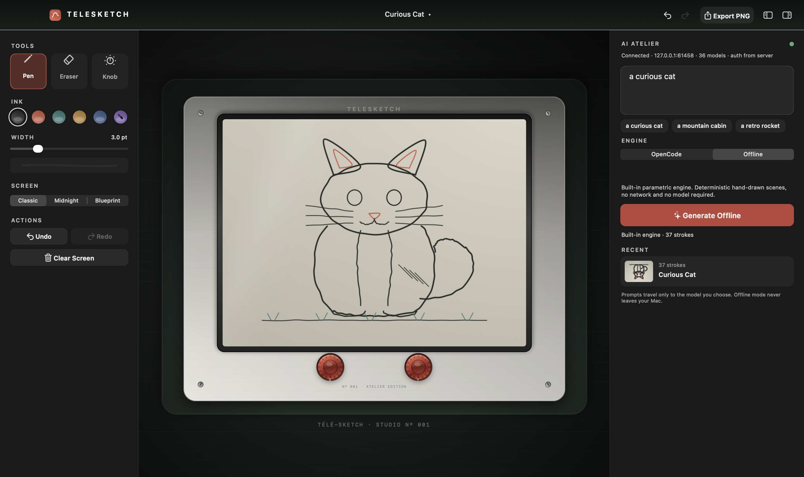

# Telesketch

A native macOS drawing studio inspired by the Télé-Sketch toy: a photoreal aluminium
drawing machine, twin vermilion knobs, a glass screen, and an AI atelier that turns
prompts into line art. Everything is built with **Objective-C and AppKit** — no Swift,
no SwiftUI, and no external art assets.



## Highlights

- **Hand-drawn sketches** — pressure- and speed-sensitive ink, Catmull-Rom smoothing,
  six semantic ink colours, adjustable nib width, and stroke erasing.
- **Tactile device mode** — turn the horizontal and vertical knobs to drive a virtual
  stylus, just like the mechanical toy.
- **OpenCode AI atelier** — ask for a subject, stream a model-generated line drawing,
  and watch it plot itself stroke by stroke. The app launches a private OpenCode server
  and reads both the URL and the password from the helper's output. You can also point it
  at an existing server and set that server's password in Settings.
- **Offline atelier that always works** — a deterministic, seeded parametric sketch
  engine draws cats, houses, rockets, landscapes and more with no network, model, or
  OpenCode installation.
- **Trace an image** — open a photo or sketch and Vision contour detection turns it into
  editable line strokes, aspect-fitted to the 4:3 screen.
- **Studio workflow** — NSDocument-based `.telesketch` files, snapshot undo/redo,
  shake-to-clear, recent generations, PNG/SVG/PDF export, and Classic, Midnight and
  Blueprint screen themes.
- **Procedural visuals** — aluminium, glass, leather, oak, screws, knobs, grain and
  the app icon are drawn in code. There are no bitmap assets to lose.

## Requirements

- macOS 13.0 or newer for the app (the test bundle uses macOS 14 because of the
  XCTest runtime shipped with current Xcode).
- Xcode with the macOS SDK. Developed and verified with **Xcode 27.2**.
- [XcodeGen](https://github.com/yonaskolb/XcodeGen) (`brew install xcodegen`).
- OpenCode is optional. Install it and authenticate once if you want the cloud/local
  AI atelier:

  ```sh
  opencode auth login
  ```

  The app searches `~/.opencode/bin/opencode`, `/opt/homebrew/bin/opencode`,
  `/usr/local/bin/opencode`, and the login shell's `PATH`. You can also set an explicit
  binary path in **Telesketch → Settings… → AI**. To use a server that is already
  running, enter its URL and password in the same pane; the app connects to it instead of
  spawning a helper and never shuts it down.

## Build, run, test

```sh
./Scripts/generate_project.sh   # regenerate Telesketch.xcodeproj from project.yml
./Scripts/build.sh              # build build/Build/Products/Debug/Telesketch.app
./Scripts/run.sh                # build and open the app
./Scripts/test.sh               # run the 49 unit tests
```

Or directly:

```sh
xcodebuild -project Telesketch.xcodeproj -scheme Telesketch \
  -configuration Debug -derivedDataPath build build

xcodebuild -project Telesketch.xcodeproj -scheme Telesketch \
  -derivedDataPath build test

open build/Build/Products/Debug/Telesketch.app
```

The committed `.xcodeproj` is generated from `project.yml`. If you add files, rerun
`./Scripts/generate_project.sh`.

### App icon

```sh
./Scripts/make_icon.sh
```

The Objective-C icon generator renders a 1024 px master, writes every required iconset
size, produces `Telesketch/Resources/AppIcon.icns`, verifies the round trip with
`iconutil`, and regenerates the project. The master preview is written to
`build/icon/AppIcon-1024.png`.

## Drawing

- Draw directly on the screen with the mouse or trackpad.
- Select **Pen**, **Eraser** or **Knob** in the left rail.
- Change ink with the six swatches or the custom colour swatch.
- Drag the width slider for a 0.6–12 pt nib.
- **Knob mode**: drag either physical knob. The horizontal knob moves the stylus in X;
  the vertical knob moves it in Y, leaving a continuous ink line.
- **Undo / Redo** cover strokes, erases, clears, theme changes and generated sketches.
- **Clear Screen** shakes the device, dissolves the ink and gives haptic feedback where
  supported. Reduce Motion skips the shake.
- **Trace Image…** in the File menu (or the tool rail button) converts an image into
  strokes using Vision contour detection. The result is a normal undoable drawing that
  can be edited, saved and exported like any other sketch.

Keyboard:

| Action | Shortcut |
| --- | --- |
| Pen / Eraser / Knob | `B` / `E` / `K` |
| Choose ink 1–6 | `1`–`6` |
| Thinner / thicker nib | `[` / `]` |
| Undo / Redo | `⌘Z` / `⇧⌘Z` |
| Shake to clear | `⌘K` |
| Generate with AI | `⌘↩` |
| Generate offline | `⇧⌘↩` |
| Cancel generation | `Esc` |
| Toggle tool rail | `⌘⌥1` |
| Toggle AI atelier | `⌘⌥2` |
| Trace image | `⇧⌘I` |
| Export PNG | `⇧⌘E` |

Export SVG and PDF from the File menu. All three formats use the document's current
theme and drawing.

## The AI atelier

The right rail has a prompt card, three suggestion chips, an engine switch, a model
picker and a generate button (plus cancel while a request is in flight).

### OpenCode mode

When the OpenCode engine is selected, the app:

1. Finds the OpenCode binary.
2. Starts a private helper with
   `opencode serve --hostname 127.0.0.1 --port 0`.
3. Reads the actual URL and generated password from the server's stdout. Nothing is
   hard-coded.
4. Authenticates with HTTP Basic (`opencode:<password>`), loads
   `GET /api/model`, and filters active chat models.
5. Sends a strict JSON-only drawing prompt to
   `POST /api/experimental/generate/text`, parses the result tolerantly, and reveals the
   stroke-by-stroke drawing.
6. Retries once with a tighter repair prompt if the model returns malformed JSON.

If **External Server** is set in Settings, steps 1–3 are skipped: the app connects to
that URL with the configured password, uses the same model catalogue and generation
endpoint, and leaves the external server running when Telesketch quits. The password
field is optional for servers that do not require auth.

Local Ollama/llama.cpp models are tagged **Local** in the model picker. Free cloud
models can be rate-limited (HTTP 429/502 `rate_limit`); the app recognises both forms.
If that happens while a local Ollama model is available, Telesketch switches to it
automatically and continues drawing instead of dead-ending on the quota error. The
status line reports the switch, and the local model remains selected for the next
generation. You can switch back at any time from the model picker. Missing credentials,
auth failures, provider errors, unavailable models, timeouts and cancellation all have
readable status messages. The OpenCode log is at
`~/Library/Logs/Telesketch/opencode.log` and can be revealed from the Help menu.

The model picker is populated from `/api/model`; use the refresh button after starting
Ollama or adding credentials. A one-shot app-level smoke test lives behind a developer
environment flag:

```sh
TS_SMOKE_OPENCODE=1 ./build/Build/Products/Debug/Telesketch.app/Contents/MacOS/Telesketch
```

It starts the helper, verifies URL/password capture, loads models, generates with the
first local model, parses the drawing and exits. The smoke run uses a deliberately tiny
two-stroke JSON prompt so it tests the integration rather than 3B-model artistry; three
consecutive runs passed with `llama3.2:3b` (2–3 strokes, 6–9 points), leaving no orphan
helper processes. Normal prompts can still produce crude or invalid drawings. The parser
repairs HTML-escaped quotes, stray comparison characters, dangling separators and
token-truncated JSON (including salvaging complete strokes before a cut-off point). The
app retries once with a repair prompt, and the offline engine is the reliable fallback.

A second harness mode exercises the real atelier prompt, including that repair retry:

```sh
TS_SMOKE_PRODUCTION=1 TS_SMOKE_PRODUCTION_ATTEMPTS=3 \
  ./build/Build/Products/Debug/Telesketch.app/Contents/MacOS/Telesketch
```

Raw model output is written to `/tmp/ts-production-smoke-*.txt`. Three production
attempts passed: 5 strokes/42 points and 9 strokes/33 points on the primary prompt, and
one primary response with a single stroke that recovered to 5 strokes/16 points via the
repair prompt. No orphan helpers were left behind.

### Offline mode

The built-in engine is deterministic and network-free. It recognises English and French
keywords for cat, dog, house, tree, flower, mountain, rocket, car, fish, bird, robot,
face/portrait, and abstract compositions. Unknown prompts fall back to a seeded landscape
of hills, sun/moon, waves and foliage. Detail words such as “minimal”, “detailed” and
“comic” change stroke density and jitter. Every result uses semantic colour roles, so it
recolours cleanly when the screen theme changes.

## Documents and themes

- Files use the `.telesketch` extension (UTI `com.sid.telesketch.drawing`) and a simple
  versioned JSON schema.
- **Save**, **Save As**, **Open Recent** and corrupt-file rejection are handled by the
  `NSDocument` architecture.
- Generated drawings are undoable snapshots. Recent generations (the last five) appear
  as thumbnail cards and can be re-applied.
- **Classic** — warm paper, graphite ink, vermilion knobs.
- **Midnight** — deep green-black screen with ivory ink.
- **Blueprint** — navy drafting screen with pale ink.
- **Export** from the toolbar or File menu: PNG at retina-friendly resolution, SVG with
  the full vector background, or a vector PDF with a clean flat themed paper colour.
  SVG keeps the gradient and vignette; PDF deliberately uses a solid background because
  Quartz renders alpha gradients as opaque black and bands `NSGradient` shadings.

## Design notes

- Window: 1440 × 900, minimum 1180 × 760, centred with frame autosave.
- Three-column studio: 248 pt tool rail, flexible stage, 348 pt AI atelier. Both rails
  collapse with a spring animation.
- The device, desk, glass, knobs, screws and icon are rendered procedurally with AppKit
  gradients, Bézier paths, shadows and deterministic texture.
- Screen ink is a two-pass “metal powder” stroke: a soft halo under a crisp core.
- The app respects Reduce Motion and Increase Contrast, and exposes accessibility labels
  and tooltips on the main controls.

## Project layout

```text
Telesketch/
  App/           main, app delegate, menus, developer harness
  Models/        vertex, stroke, drawing, theme
  Controllers/   NSDocument, window, main view, settings
  Views/         stage, device, knob, canvas, buttons, prompt, history
  Render/        stroke/background renderer, colour parsing
  Services/      OpenCode, prompt builder, parser, offline engine, tracer, exporters
  Resources/     Info.plist, AppIcon.icns
TelesketchTests/ parser, serialization, offline engine, tracer, export, OpenCode settings
Tools/IconGen/   procedural icon generator
Scripts/         project generation, icon, build, test, run
Docs/            screenshot used above
```

Model and parser services are Foundation-only so they can be tested headlessly. The app
uses ARC, modern Objective-C, the `TS` class prefix, protocol-based services and an
`NSDocument` undo manager.

## Tests

The test suite covers:

- parser variants (fenced, prose-wrapped, bare arrays, 0–100 coordinates, clamping,
  invalid JSON, over-limit inputs, colour fallback, HTML-escaped key quotes, stray
  comparison characters, dangling separators, truncated final braces and salvaged
  truncated strokes),
- JSON round trips, corrupt/truncated/newer-version rejection, theme remapping and stroke
  mutation,
- offline-engine determinism, bounds, scene coverage and French synonyms,
- image tracing from a synthetic image (stroke count, bounds and 4:3 fitting),
- PNG/SVG/PDF export dimensions, SVG XML parsing, PDF page geometry, and a rendered PDF
  check that rejects black backgrounds and confirms visible vector strokes, and
- OpenCode external-server URL normalisation, password persistence, external-mode
  detection, and rate-limit detection for both plain HTTP 429 and wrapped HTTP 502
  provider payloads.

Current result: **49 tests, 0 failures**, Debug build with **no compiler warnings**.

## Limitations

- **Local builds are unsandboxed.** Spawning the OpenCode helper is incompatible with the
  App Sandbox. A distribution build would need an external server, a signed helper, or a
  different transport; the current build is ad-hoc signed and not notarised.
- **PDF export uses a flat paper background.** Quartz PDF shadings render `NSGradient`
  alpha vignettes as opaque black and band smooth gradients, so PDF files keep the
  themed paper colour but omit the screen gradient and grain. SVG and PNG keep the full
  background treatment.
- **Cloud model quotas vary.** Free models can be rate-limited. The app handles this and
  points to Offline mode.
- **Small local models are experimental.** `llama3.2:3b` can produce valid sketches but
  its output is inconsistent; larger local models give better results.
- **Image tracing is contour-based.** It works best on high-contrast line art, logos and
  clear silhouettes; detailed photographs produce a stylised subset of contours rather
  than a photographic reproduction.
- Recent generations are kept in memory only and are not saved into the document.
- Layers, raster brushes, cloud sync and collaboration are intentionally out of scope.
- The screenshot and smoke-test hooks in `TSDeveloperHarness` only activate when their
  environment variables are set; normal launches ignore them.

--

Built as a native macOS portfolio project. © 2026 Sid.
